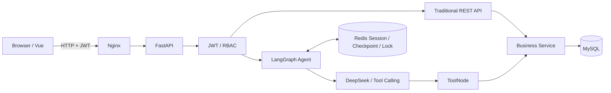

# Smart OA Agent V2

## 项目简介

Smart OA Agent V2 是一个结合 AI Agent 与传统 Web 操作界面的 OA 请假审批系统。员工既可以通过自然语言完成请假、查询和撤销，也可以使用普通表单；主管和 HR 可分别完成两级审批，管理员可维护用户与查看审计日志。

系统使用 FastAPI 承载认证、权限和业务 API，LangGraph 负责多轮会话与 Tool Calling，Vue 3 提供多角色页面，MySQL 保存业务事实，Redis 保存会话与 Checkpoint。所有权限判断、写操作确认和数据库变更均由服务端控制，模型不能直接写入数据库。

## 核心功能

- 自然语言请假与多轮参数补全
- AI Agent 与传统 Web OA 双通道操作
- 写操作确认快照，避免模型在未确认时执行提交、撤销或审批
- JWT 登录、首次登录强制改密与 RBAC 角色权限
- 员工请假提交、查询和撤销
- 主管审批、团队请假查询与 HR 终审
- 用户管理、通知、待办和审计日志
- MySQL 事务、`BusinessOperation` 幂等记录与业务持久化
- Redis Session、LangGraph Checkpoint 和会话并发协调
- Redis 不可达时 Agent Chat 安全失败，传统 REST 业务仍可使用 MySQL 继续运行
- Docker Compose 四服务部署与 Nginx 统一入口

### 七个 Agent 业务工具

| Tool | 角色 | 作用 |
| --- | --- | --- |
| `submit_leave` | employee | 提交已确认的请假申请 |
| `query_my_leave` | employee | 查询本人请假记录 |
| `cancel_leave` | employee | 撤销本人仍可撤销的申请 |
| `query_manager_pending` | manager | 查询当前主管的待审批申请 |
| `manager_review` | manager | 批准或拒绝直属员工申请 |
| `query_hr_pending` | hr | 查询等待 HR 终审的申请 |
| `hr_review` | hr | 完成最终批准或拒绝 |

Tool 不接受模型提供的可信用户身份、角色或 `operation_id`。这些信息由 FastAPI 请求上下文和后端编排注入。

## 技术栈

| 层 | 实现 |
| --- | --- |
| Frontend | Vue 3、Vite、Vue Router、Pinia、Element Plus、Axios、dayjs |
| Backend | Python 3.11、FastAPI、Uvicorn、Pydantic Settings、SQLAlchemy、PyMySQL |
| Agent | LangGraph、LangChain、`langchain-openai`、ToolNode、OpenAI-compatible Chat API |
| LLM | DeepSeek API；Base URL 和模型可通过环境变量配置 |
| Data | MySQL 8、Redis 8、项目内 `Redis7CheckpointSaver` |
| Delivery | Docker Compose、Nginx、pnpm |

精确依赖版本以 [`backend/requirements.txt`](backend/requirements.txt)、[`frontend/package.json`](frontend/package.json) 和 [`compose.yml`](compose.yml) 为准。

## 系统架构



MySQL 是用户、请假、审批、通知、审计和幂等结果的事实源。Redis 只承载对话与并发协调；Redis 不可用时 Chat 返回服务不可用，但不阻止直接依赖 MySQL 的传统 OA 路由运行。详细数据流见[系统架构与关键数据流](docs/architecture.md)。

## 快速开始

### 前置依赖

- Git，或能够下载并解压源码 ZIP
- Docker Desktop，并启用 Linux Container Engine
- 可访问 DeepSeek API 的网络环境
- 使用者自己的 DeepSeek API Key

完整 Compose 部署会在容器内构建前后端并运行 MySQL、Redis。宿主机不需要另外安装 Python、Node.js、MySQL 或 Redis。

### 下载源码

```powershell
git clone https://github.com/gudugudu0921/Smart-OA-Agent-V2.git
cd Smart-OA-Agent-V2
Copy-Item .env.example .env
```

Linux/macOS 使用：

```bash
git clone https://github.com/gudugudu0921/Smart-OA-Agent-V2.git
cd Smart-OA-Agent-V2
cp .env.example .env
```

## 环境变量配置

编辑根目录 `.env`：

- `LLM_API_KEY`：填写自己的 DeepSeek API Key
- `MYSQL_PASSWORD`：MySQL 应用账号随机密码
- `MYSQL_ROOT_PASSWORD`：MySQL root 随机密码，必须与应用账号密码不同
- `REDIS_PASSWORD`：Redis 随机密码
- `JWT_SECRET_KEY`：至少 32 字符的随机 Secret
- `APP_HTTP_PORT`：浏览器端口，默认 `8080`

`.env.example` 已提供 `https://api.deepseek.com` 和 `deepseek-flash` 作为默认 LLM 配置。请根据自己的 DeepSeek 账号实际能力调整，且不要提交填写过秘密的 `.env`。

PowerShell 可用以下命令生成一个 32-byte 随机值；为 MySQL 应用账号、MySQL root、Redis 和 JWT 分别执行一次：

```powershell
$b = New-Object byte[] 32; $r = [System.Security.Cryptography.RandomNumberGenerator]::Create(); $r.GetBytes($b); [Convert]::ToBase64String($b); $r.Dispose()
```

Linux/macOS 可使用：

```bash
openssl rand -base64 32
```

验证配置并启动：

```powershell
docker compose config --quiet
docker compose up -d --build --wait
docker compose ps
```

浏览器访问：

```text
http://localhost:8080
```

如果修改了 `APP_HTTP_PORT`，请使用对应端口。

## 账号初始化

首次启动会在全新空 MySQL volume 中自动创建当前表结构，但不会自动创建登录账号。请在以下两种方式中选择一种。

### 方式一：初始化本地演示账号

仅在全新、独立、可丢弃的本地 Compose 数据库中运行：

```powershell
docker compose exec -e APP_ENV=development backend python -m app.db.seed_users
```

该命令创建虚构的 admin、manager、hr 和 employee，并只显示一次随机临时密码。已有账号不会被重复创建或覆盖密码。请安全保存临时密码，并在各账号首次登录时按页面提示修改。

### 方式二：只创建首个管理员

```powershell
docker compose exec backend python -m app.db.create_admin
```

Bootstrap 仅允许在 `users` 表为空时执行。创建管理员后，可在“用户管理”页面继续创建其他虚构角色。不要同时执行两种初始化方式，也不要在已有业务数据库上运行 development seed。

## 使用指南

| 角色 | 页面入口 | 可用操作 |
| --- | --- | --- |
| employee | Agent 助手、我的请假 | 自然语言提交/查询/撤销；在“我的请假”右上角点击“新建请假”；撤销仍可撤销的申请 |
| manager | Agent 助手、待我审批、团队请假 | 查询待审批申请，批准或拒绝直属员工申请，查看团队历史 |
| hr | Agent 助手、HR 审批、全部请假 | 查询待终审申请，完成 HR 终审，按状态、类型和部门查询全部申请 |
| admin | Agent 助手、用户管理、审计日志 | 创建和管理用户、角色及组织关系；只读查看关键业务审计 |

页面会显示与当前用户相关的通知和待办。Agent 写操作在真正执行前会展示确认内容；请核对申请、日期和审批决定后再确认。

正常停止并保留数据卷：

```powershell
docker compose down
```

不要把 `docker compose down -v` 当作常规停止命令；`-v` 会删除当前 Compose 项目的数据卷。

## 项目结构

```text
Smart-OA-Agent-V2/
├── backend/      # FastAPI、LangGraph、Tool、Service、Model、Tests
├── frontend/     # Vue、Pinia、Agent UI、传统 OA 页面、Nginx
├── docs/         # 架构、部署、开发和截图文档
├── scripts/      # 项目辅助脚本
├── compose.yml
└── README.md
```

## 技术文档

- [系统架构与关键数据流](docs/architecture.md)
- [本地部署与开发指南](docs/demo-guide.md)
- [项目截图](docs/screenshots/README.md)
- [后端开发说明](backend/README.md)
- [前端开发说明](frontend/README.md)

## 常见问题

### `/health` 正常是否表示 DeepSeek 可用？

不是。健康接口检查应用及内部依赖，不会调用模型。完成首次改密后，可发送一条只读自然语言查询验证自己的 API Key、模型和额度。

### `/health` 显示 degraded，但 `/ready` 正常

通常表示 Redis 不可用而 MySQL 正常。Agent Chat 会安全返回服务不可用；传统登录、请假、审批和通知 REST 路由仍可运行。恢复 Agent 前应先排查 Redis 连接。

### Fresh Install 没有自动建表

`backend/app/db/init_mysql.sql` 只会在 MySQL 官方镜像首次初始化空数据目录时执行。已有 named volume 不会自动重放初始化脚本，也不会自动迁移。

### 账号无法登录

使用初始化命令当次显示的临时密码，并在首次登录后改密。重复运行 seed 不会覆盖已有账号密码。

### 8080 端口被占用

修改 `.env` 中的 `APP_HTTP_PORT`，重新启动 Compose，并使用新端口访问。

### 生产部署注意事项

默认 Compose 面向本地运行，使用 HTTP。公网部署前需要配置 HTTPS、可靠的 Secret 管理、备份恢复、日志监控和独立安全评估；LLM 可用性、费用和数据策略取决于所配置的 Provider。

## License

[MIT License](LICENSE)
