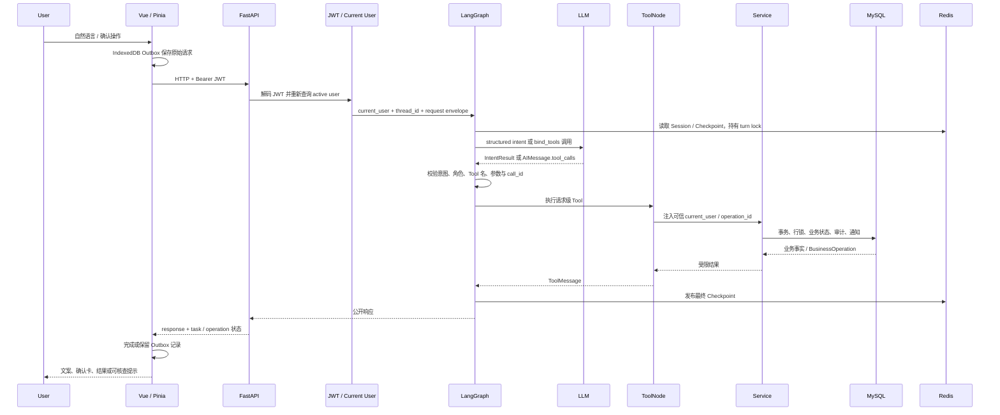

# Smart OA Agent 系统架构

本文描述当前仓库的模块边界、核心数据流和安全约束，内容以实际代码实现为准。

## 1. 模块边界

```text
frontend/src/
├── api/          Axios API 适配
├── components/   Chat、确认卡、结果卡和通用组件
├── services/     IndexedDB Outbox、跨标签页协调
├── stores/       Pinia 认证和聊天状态
└── views/        员工、主管、HR、管理员页面

backend/app/
├── api/routes/   HTTP 路由、依赖注入、公开响应
├── agents/       LangGraph、结构化意图、任务协议
├── tools/        请求级 Tool 与 Service 适配
├── services/     事务、权限、状态机、幂等、通知、审计
├── models/       SQLAlchemy 业务模型
├── schemas/      Pydantic API/确认结构
├── db/           MySQL、Redis Checkpointer、初始化与迁移
└── core/         配置、JWT、异常、日志与 Request ID
```

基本原则：Graph 负责编排，Tool 负责受控适配，Service 负责真正的业务规则与事务。Tool 不绕过 Service 直接修改 ORM。

## 2. 前后端数据流



Docker Compose 模式下，浏览器先访问 Nginx；`/api/` 反向代理到 `backend:8000`。本地开发模式没有 Vite proxy，前端通过 `VITE_API_BASE_URL` 直接访问 FastAPI。

## 3. LangGraph State 与结构化意图

[`backend/app/agents/chat_state.py`](../backend/app/agents/chat_state.py) 中的 `ChatState` 保存：

- 对话消息与本轮输入
- 后端注入的 `user_id`、角色、部门和主管关系
- `pending_intent`、`pending_fields`、已提取参数和最近查询结果
- `message_request_id`、`operation_id`、`task_action`、`task_revision`
- 确认快照、指纹、任务阶段和已关闭操作 ID

[`recognition.py`](../backend/app/agents/recognition.py) 使用 Pydantic `IntentResult` 和 `with_structured_output(..., method="function_calling")` 识别八类意图：七个业务意图加 `general_chat`。LLM 只负责识别与提取，不决定权限，也不执行数据库操作。

缺少必填字段时，Graph 将任务保持为 `COLLECTING`；参数完整且业务目标可核验后，生成 `AWAITING_CONFIRMATION` 快照。下一轮补充信息会与 Checkpoint 中的可信任务状态合并。

Redis 中还保存 Session metadata、用户 Session 索引、LangGraph Checkpoint 和会话 turn lock。`_TurnBufferedCheckpointSaver` 会在持锁期间缓冲本轮写入，只发布最终状态，降低过期执行覆盖新状态的风险。

## 4. 七个 Tool 的真实机制

### 4.1 Tool 与角色

| Tool | 允许角色 | 类型 |
| --- | --- | --- |
| `submit_leave` | employee | 写 |
| `query_my_leave` | employee | 读 |
| `cancel_leave` | employee | 写 |
| `query_manager_pending` | manager | 读 |
| `manager_review` | manager | 写 |
| `query_hr_pending` | hr | 读 |
| `hr_review` | hr | 写 |

角色到意图的白名单位于 [`chat_agent.py`](../backend/app/agents/chat_agent.py)。Admin 的 Agent 当前只允许 `general_chat`。

### 4.2 Tool Schema

Tool Schema 描述模型可以调用的工具名、说明和参数。查询 Tool 无 `user_id` 参数；写 Tool 也只暴露当前业务动作必要的字段。例如主管审批只允许 `application_id`、`decision` 和可选 `comment`。

### 4.3 请求级 BaseTool

Tool 不是全局共享的无身份函数。每次请求都会用 FastAPI 已认证的 `current_user`、数据库 Session 或 Session factory 构造新的 `BaseTool`：

- 查询 Tool：[`backend/app/tools/query_tools.py`](../backend/app/tools/query_tools.py)
- 提交/撤销 Tool：[`backend/app/tools/leave_tools.py`](../backend/app/tools/leave_tools.py)
- 主管/HR 审批 Tool：[`backend/app/tools/approval_tools.py`](../backend/app/tools/approval_tools.py)

因此模型即使生成 `user_id`、`manager_id`、角色或数据库信息，也不会成为授权依据。

### 4.4 bind_tools、tool_calls、ToolNode 与 ToolMessage

1. Graph 用 `get_llm().bind_tools([tool])` 将本轮唯一允许的 Tool Schema 绑定到模型。
2. 模型返回 `AIMessage.tool_calls`。
3. Graph 验证消息类型、非法调用、调用数量、Tool 名、参数集合和值。
4. `ToolNode` 执行通过校验的请求级 Tool。
5. Tool 返回 `ToolMessage`；Graph 校验 `ToolMessage.tool_call_id` 与原调用 ID 对应，再读取受限 artifact。

读 Tool 和已确认写 Tool 都真实经过 ToolNode。写路径使用隔离的小 Graph，避免历史消息或其他 Tool 污染本次调用。

## 5. 读操作与写操作

### 5.1 读操作

三种查询在角色白名单通过后，走：

```text
structured intent
→ bind_tools
→ AIMessage.tool_calls
→ 参数与 call_id 校验
→ ToolNode
→ 角色受控 Service 查询
→ ToolMessage
→ 最终文本与结构化列表
```

查询本人记录会绑定当前 employee；主管待办按当前 manager 的分配关系查询；HR 待办只返回主管已批准、仍等待终审的记录。

### 5.2 写操作

四种写操作额外经过：

```text
参数收集与目标查询
→ 可信确认快照
→ task_revision + confirmation_fingerprint
→ 用户结构化 confirm
→ 发布 EXECUTING Checkpoint
→ 后端绑定 operation_id/current_user
→ LLM 生成唯一 Tool 调用
→ ToolNode
→ 幂等 Service + BusinessOperation
→ MySQL 最终状态核查
→ SUCCEEDED / FAILED / UNKNOWN
```

确认卡不是“让模型再问一句”。它绑定申请目标、日期、审批决定、评论、任务版本和请求指纹。确认请求的 revision 或参数不匹配时，后端拒绝执行。

模型负责生成符合 Schema 的调用；是否允许执行、调用参数是否等于已确认快照、当前用户是否有权操作，以及数据库是否能提交，全部由后端校验。

## 6. JWT、当前用户与 RBAC

认证与授权是两层概念：

- **认证**：[`get_current_user`](../backend/app/core/dependencies.py) 验证 JWT 签名、有效期和 `sub`，然后从 MySQL 重新查询用户，拒绝不存在或停用账号。密码变更时间还会使旧 Token 失效。
- **授权**：`get_current_business_user` 阻止未完成首次改密的账号访问业务接口；`require_roles` 负责路由角色白名单；Graph、Tool 与 Service 再检查具体角色、直属关系、申请所有权和状态。

前端菜单和路由守卫只改善体验，不是安全边界。自然语言中的“我是 HR”不会改变 JWT 对应的真实用户。

## 7. MySQL 与 Redis 的分工

### MySQL：业务事实源

MySQL 保存：

- `users`
- `leave_applications`
- `notifications`
- `audit_logs`
- `business_operations`

申请状态、审批结果、通知、审计和幂等终态都必须以 MySQL 为准。删除聊天 Session 不会删除业务申请。

### Redis：对话与并发协调

Redis 保存：

- Session metadata 与用户 Session 索引
- LangGraph Checkpoint、pending writes
- 多轮参数、确认快照和任务阶段
- message receipt / request coordination
- chat turn lock

Redis 不保存请假、通知或审计的最终事实。Redis 不可用时 Agent 会话不可用；传统 OA 接口仍以 MySQL 为核心。`/health` 会显示 degraded，`/ready` 只以 MySQL 是否可用决定就绪。

## 8. 幂等、事务与恢复

### 8.1 operation_id 与指纹

前端为业务候选生成 UUID v4 `operation_id`，但写 Tool 不允许模型自行提供它。后端把它绑定到：

- 已认证 actor
- operation type
- 规范化 payload 的 SHA-256 指纹
- fingerprint version

同一 `operation_id` 绑定不同 actor、操作类型或参数时会冲突；不会被当成一次新操作。

### 8.2 BusinessOperation 与行锁

`BusinessOperation` 状态为 `PROCESSING`、`SUCCEEDED`、`FAILED` 或 `UNKNOWN`。Service 先预留记录，再在业务事务中用 `SELECT ... FOR UPDATE` 锁定操作记录和目标业务行，保证申请、审计、通知、重放结果和终态一致提交。

`SUCCEEDED` 只重放经过资源 ID 核验的最小结果；`FAILED` 不会自动改成成功；已有 `PROCESSING` 不会并行执行第二次。

### 8.3 UNKNOWN

如果提交结果无法安全确认，系统使用 `UNKNOWN`，前端提示用户核查，而不是猜测成功或自动换一个 `operation_id` 重试。`GET /operations/{operation_id}` 只允许 actor 查询自己的记录，并只返回安全投影。

### 8.4 Outbox 与消息回执

[`frontend/src/services/chatOutbox.js`](../frontend/src/services/chatOutbox.js) 在发出 HTTP 前，把完整不可变请求保存到 IndexedDB，包括：

- `thread_id`
- `message_request_id`
- `operation_id`
- `task_action`
- `task_revision`
- 原始 message

网络不确定时记录转为 `NEEDS_RECONCILIATION`，保留原标识，不自动生成新请求。刷新恢复时先读取 Outbox、Redis 任务投影和 MySQL Operation；只有结果可验证时才清理。`BroadcastChannel` 只做同一用户多标签页的确认竞争提示，不替代服务端幂等。

当前实现没有通用后台自动重试、任意租约接管或跨灾难环境恢复，不能据此宣称 exactly-once 分布式事务。

## 9. 通知与审计

业务 Service 在同一 MySQL 事务中写申请状态、审计和通知：

- 创建申请：通知直属主管
- 主管批准：通知员工和 active HR
- 主管拒绝：通知员工
- HR 批准/拒绝：通知员工
- 撤销：记录审计，不额外发送通知

通知待办按当前业务状态查询，不以“通知是否已读”代替业务状态。审计包含 action、resource、actor、详情、IP 与 Request ID 等受控字段。

## 10. 常见故障定位

| 现象 | 优先检查 | 系统行为 |
| --- | --- | --- |
| LLM structured output 失败 | Provider、模型配置、`recognition.py` | 返回统一 LLM 错误，不执行 Tool |
| 非法或多个 `tool_calls` | Tool 名、参数、调用数量、call_id | Graph 校验失败，ToolNode 不执行 |
| 401 / 403 | Token、active user、首次改密、角色 | FastAPI 依赖先拒绝 |
| 主管看不到申请 | `manager_id`、申请状态、Service 查询 | 不放宽为全局查询 |
| Redis 不可用 | `/health`、`/health/redis`、Redis 配置 | Agent/会话失败；MySQL 业务接口可继续 |
| MySQL 不可用 | `/ready`、连接参数、目标实例 | Readiness 503，业务写入停止 |
| 写操作结果不确定 | Operation、Outbox、原 request ID | 显示核查提示，不盲重试 |
| 刷新后确认异常 | Redis task、revision、IndexedDB Outbox | 恢复、隔离或要求核查 |
| Tool/Service 异常 | Tool artifact、Service 校验、Request ID | 统一错误映射，避免虚报成功 |

## 11. 已知边界

- 单体 FastAPI + MySQL + Redis 架构，未实现微服务或消息队列
- 无集中式日志、生产级 Secret Manager、自动灾难恢复或跨地域高可用
- JWT 当前保存在浏览器 localStorage
- Compose 默认 HTTP
- 外部 LLM 的延迟、费用、配额和数据策略不由本项目控制
- 测试证明的是已覆盖场景，不等价于形式化安全证明或无限并发能力

返回 [README](../README.md)。
